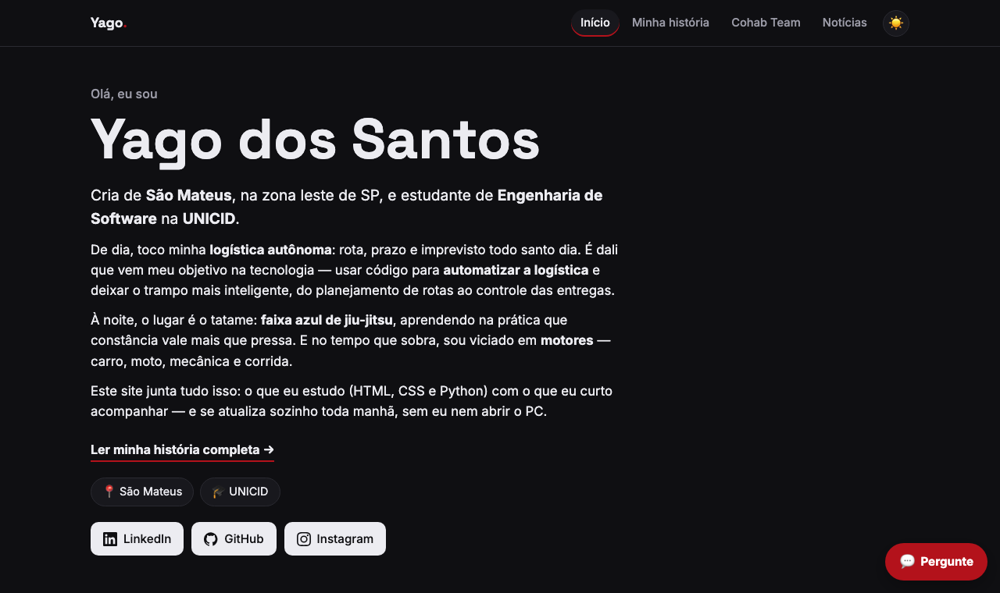

<p align="center">
  
</p>

<p align="center">
  <a href="https://yagoxavier10.github.io/portfolio-noticias/"></a>
  <a href="https://github.com/YagoXavier10/portfolio-noticias/actions/workflows/update-news.yml"></a>
  <a href="https://github.com/YagoXavier10/portfolio-noticias/actions/workflows/update-cohab.yml"></a>
</p>

<p align="center">
  
  
  
  
  
</p>

Portfólio do Yago dos Santos: página estática que se atualiza sozinha todo dia com manchetes de
**Inteligência Artificial, Ciência de Dados, Corinthians, Motores, Tecnologia, Política, Economia Brasileira,
Fintechs, Jiu-Jitsu e Campeonatos de Jiu-Jitsu em SP**.

## 📸 Prévia

<p align="center">
  <a href="https://yagoxavier10.github.io/portfolio-noticias/"></a>
</p>

## ⚙️ Como funciona

🌐 https://yagoxavier10.github.io/portfolio-noticias/

- `scripts/fetch_news.py` — Python + `requests`: busca as notícias e salva em `data/news.json`
- `index.html` / `style.css` / `app.js` — a página (apresentação, redes sociais e cartões com filtro por tema)
- `cohab.html`, `conquistas.html`, `atletas.html` — história, conquistas e busca de atletas da Cohab Team
- `scripts/update_cohab.py` — busca conquistas novas da Cohab (CBJJE/FESP, IBJJF, FPJJ, Smoothcomp); dados brutos em `data/cohab/`
- `.github/workflows/update-cohab.yml` — roda o script toda segunda-feira às 06:00 (Brasília)
- `.github/workflows/update-news.yml` — roda o script todo dia às 07:00 (Brasília) e faz o commit

## 💻 Rodar localmente

```bash
pip install -r requirements.txt
python scripts/fetch_news.py
python -m http.server 8000   # abra http://localhost:8000
```

## 🚀 Publicar no GitHub

1. Crie um repositório **público** e envie estes arquivos.
2. **Settings → Pages** → Source: *Deploy from a branch* → `main` / `(root)`.
3. **Actions** → *Atualizar notícias* → **Run workflow** para testar na hora.

O site fica em `https://SEU-USUARIO.github.io/NOME-DO-REPO/`.

> O robô faz um commit por dia, então rode `git pull` antes de editar.

## 🗞️ Fonte das notícias

Por padrão usa o **RSS do Google News** (sem chave). Para usar a **NewsAPI**, crie uma chave em newsapi.org
e adicione em **Settings → Secrets and variables → Actions → New repository secret** com o nome `NEWSAPI_KEY`.

Para mudar os temas, edite o dicionário `TOPICS` no topo de `scripts/fetch_news.py`.
`LIMITS` define temas que mostram mais notícias que o padrão (6).

## 📄 Licença

Distribuído sob a licença MIT. Veja o arquivo [LICENSE](LICENSE).
